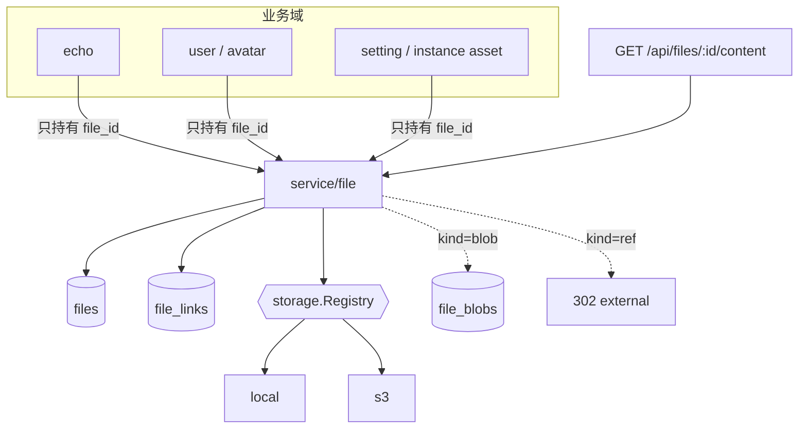

# Ech0 文件系统（File Resource System）设计

> 状态：**设计定稿，未实现**。本文件描述目标形状，不描述现有代码。
> 取代：[`storage-contract.md`](storage-contract.md) 中"四类对象 + `Ref` 寻址"的目标模型；该文的启动迁移与 URL 重写部分随本设计一并作废。
> 关联：[`architecture-overview.md`](architecture-overview.md)、[`timezone-design.md`](timezone-design.md)（时间为 UTC epoch 整数）、[`roles-and-permissions.md`](roles-and-permissions.md)。

## 0. 一句话

文件只有一个元数据表（`files`）、一个对外身份（`file_id`）、一个内容出口（`/api/files/{id}/content`）；字节存在哪里由行上的 `kind` 决定，业务层永远看不到存储 key。

## 1. 目标与非目标

### 1.1 目标

- **G1**：四种内容形态（本地磁盘、S3 兼容对象存储、数据库内 blob、外部 URL 引用）用同一张表、同一条读取路径表达，不引入能力矩阵字段。
- **G2**：新增一种存储驱动只需要实现 4 个方法 + 0 处业务改动。
- **G3**：`files` 只存**判定规则**（`access`），不存判定结果；读取时由 owner 域的 `Authorize` 向引用方询问（§7.2）。
- **G4**：内容不可变——同一 `file_id` 的字节永不改变，由此获得强缓存与稳定 ETag；写入失败以新请求重试（新 `file_id`），不做原地重试。
- **G5**：把现有 `EchoFile` / `InstanceAsset` / `users.avatar` 三套引用关系收敛成一张 `file_links`。

### 1.2 非目标（明确搁置）

- **历史数据迁移**：本设计不考虑旧 `files` 行、旧 key 布局、旧 URL 的兼容与搬迁。
- **多副本 / 跨存储搬迁编排**：一个文件固定属于写入时的存储实例，切换默认存储只影响新文件。
- **内容去重（秒传）**：一次上传对应一次写入；`sha256` 只做完整性与审计，不做共享去重（见 §14 D1）。
- **CDN 回源、签名 URL 的私有化分发**：私有内容永远不签发直连 URL（见 §14 D2）。
- **多实例部署**：与现有单进程假设一致；`Registry` 是进程内快照，不做跨进程失效。

## 2. 分层

### 2.1 四个构件

| 构件 | 存在的理由 | 只回答的问题 |
|---|---|---|
| `File`（行） | 身份 + 元数据 + 位置 | 这个文件是什么、字节在哪、谁能看 |
| `Store`（SPI） | 字节的读写通道 | 给定 key，怎么 Put/Open/Stat/Delete |
| `Registry` | `storage_id → Store` 的映射与生命周期 | 这个文件归哪个存储实例管 |
| `Gateway` | 唯一的 HTTP 内容出口 | 谁能读，以及用 302 还是流式返回 |

### 2.2 依赖方向

```
handler/file ──► service/file ──► repository/file ──► model/file
                      │
                      └────────► storage（SPI + Registry + 驱动）
```

`internal/storage` 是**叶子包**：不 import 任何 `model` 或 `service`。SPI 的方法签名只出现 `key`、`io.Reader`、`io.ReadCloser`、`BlobInfo`。



## 3. 不变量

以下七条是设计的地基。任何实现偏离都需要先改本文档。

1. **业务层只持有 `file_id`**。`storage_id` / `object_key` / `url` 不出现在任何 DTO、事件 payload 或前端代码里。
2. **内容不可变**。修改文件 = 新 `file_id` + 重建 link。禁止原地覆盖 key。
3. **key 只由 `(file_id, ext)` 决定**，且只能由 `storage.KeyFor` 生成。`file_id` 是 UUIDv7（年月前缀从 id 解出，非 v7 直接拒绝）；id 全局唯一 ⇒ 不存在覆盖写。
4. **位置在写入时固定**。`files.storage_id` 一旦写入不再变更；修改默认存储不影响既有行。
5. **可见性只有两个来源**：内生于文件（`access=public|private`），或派生自引用方（`access=owner`）。不存在第三份物化副本，也不缓存它（理由见 §7.2）。
6. **`ready` 行的存在意味着字节已写完**。`pending` 是唯一允许的例外（直传：先行后字节，24h 未 commit 即回收）。删除始终先删行、后删字节，由 `file_gc` 补偿；多出来的字节可扫可重建，丢失的行不可恢复。
7. **删除只发生一次**。没有引用计数列，没有"最后一次解引用触发删除"的隐式路径。

## 4. 数据模型

### 4.1 `files`

```go
type Kind string

const (
    KindOwned Kind = "owned" // 字节在我们管理的某个 Store 里
    KindBlob  Kind = "blob"  // 字节在 file_blobs，与行同库同事务
    KindRef   Kind = "ref"   // 字节在外部，只有一个 URL
)

// Access 不是判定结果，而是判定规则。
// public/private 内生；owner 表示"交给引用方回答"。
type Access string

const (
    AccessPublic  Access = "public"  // 无条件公开：实例资产、头像
    AccessOwner   Access = "owner"   // 跟随引用方；无 link 或全部拒绝时回落到上传者与管理员
    AccessPrivate Access = "private" // 仅上传者与管理员；永不跟随引用方
    // 注意：pending 是 Status，不是 Access。直传的 attachment 在 commit 前是 owner + pending。
)

type Status string

const (
    StatusPending Status = "pending" // 行已建，字节未确认（直传窗口）
    StatusReady   Status = "ready"   // 字节已落盘并校验通过
)

type File struct {
    ID          string     `gorm:"type:char(36);primaryKey"`
    Kind        Kind       `gorm:"type:varchar(8);not null"`
    StorageID   string     `gorm:"type:char(36)"`        // kind=owned
    ObjectKey   string     `gorm:"type:varchar(400)"`    // kind=owned
    ExternalURL string     `gorm:"column:external_url;type:text"` // kind=ref
    Name        string     `gorm:"type:varchar(255);not null"`    // 展示名，原文件名
    ContentType string     `gorm:"type:varchar(128);not null"`
    Size        int64      `gorm:"not null;default:0"`
    SHA256      string     `gorm:"type:char(64)"`
    Meta        string     `gorm:"type:text"` // JSON：宽高、时长、EXIF…
    Access      Access     `gorm:"type:varchar(8);not null;default:private"`
    Status      Status     `gorm:"type:varchar(8);not null;default:pending"`
    UploaderID  string     `gorm:"type:char(36)"` // 上传者，不是"内容所属者"
    CreatedAt   int64      `gorm:"autoCreateTime"`
    UpdatedAt   int64      `gorm:"autoUpdateTime"`
}
```

`kind` 是全函数的判别式：读取、删除、GC 三处 `switch` 都必须穷尽它，编译器不会帮你，但 `CHECK` 约束会。

DB 层把"非法状态不可表示"钉死（经 `internal/database/migration/` 一次性 migrator 下发，`AutoMigrate` 不生成 CHECK / 部分索引）：

```sql
CREATE TABLE files (
  id           TEXT    PRIMARY KEY,
  kind         TEXT    NOT NULL CHECK (kind IN ('owned','blob','ref')),
  storage_id   TEXT    REFERENCES storages(id) ON DELETE RESTRICT,
  object_key   TEXT,
  external_url TEXT,
  name         TEXT    NOT NULL DEFAULT '',
  content_type TEXT    NOT NULL DEFAULT 'application/octet-stream',
  size         INTEGER NOT NULL DEFAULT 0,
  sha256       TEXT,
  meta         TEXT,
  access       TEXT    NOT NULL DEFAULT 'private'
                       CHECK (access IN ('public','owner','private')),
  status       TEXT    NOT NULL DEFAULT 'pending'
                       CHECK (status IN ('pending','ready')),
  uploader_id  TEXT,
  created_at   INTEGER NOT NULL,
  updated_at   INTEGER NOT NULL,
  CHECK (
    (kind = 'owned' AND storage_id IS NOT NULL AND object_key IS NOT NULL AND external_url IS NULL)
 OR (kind = 'blob'  AND storage_id IS NULL     AND object_key IS NULL     AND external_url IS NULL)
 OR (kind = 'ref'   AND storage_id IS NULL     AND object_key IS NULL     AND external_url IS NOT NULL)
  )
);

CREATE UNIQUE INDEX idx_files_locator        ON files(storage_id, object_key) WHERE kind = 'owned';
CREATE INDEX        idx_files_status_created ON files(status, created_at);
CREATE INDEX        idx_files_sha256         ON files(sha256) WHERE sha256 IS NOT NULL;
CREATE INDEX        idx_files_uploader       ON files(uploader_id, created_at);
```

### 4.2 `file_blobs`

```sql
CREATE TABLE file_blobs (
  file_id TEXT PRIMARY KEY REFERENCES files(id) ON DELETE CASCADE,
  data    BLOB NOT NULL
);
```

- 与 `files` 行**同一事务**写入，因此不存在"行在、字节丢"或反向的中间态。
- 单独建表而非 `files.data` 列：避免 `SELECT *` 把大块字节读进内存，也让 `files` 的索引保持窄。
- 删除走 FK 级联，不经过 `Store`。

### 4.3 `file_links`

所有"某个业务对象拥有某个文件"的关系都落在这里。

```sql
CREATE TABLE file_links (
  file_id    TEXT    NOT NULL REFERENCES files(id) ON DELETE CASCADE,
  owner_kind TEXT    NOT NULL,  -- echo | user | instance
  owner_id   TEXT    NOT NULL,  -- echo_id / user_id / slot 名
  role       TEXT    NOT NULL,  -- attachment | cover | avatar | logo | favicon | og_image
  sort_order INTEGER NOT NULL DEFAULT 0,
  created_at INTEGER NOT NULL,
  -- sort_order 必须在键里：同一张图可以在同一条 echo 里出现两次
  PRIMARY KEY (file_id, owner_kind, owner_id, role, sort_order)
);

CREATE INDEX idx_file_links_owner ON file_links(owner_kind, owner_id, role, sort_order);

-- 单值槽位由 DB 保证，不靠 service 自觉
CREATE UNIQUE INDEX uq_file_links_slot
  ON file_links(owner_kind, owner_id, role)
  WHERE role IN ('cover','avatar','logo','favicon','og_image');
```

| 场景 | owner_kind | owner_id | role |
|---|---|---|---|
| echo 正文图片 / 附件 | `echo` | echo_id | `attachment`（`sort_order` 排序） |
| echo 封面 | `echo` | echo_id | `cover` |
| 用户头像 | `user` | user_id | `avatar` |
| 实例 logo / favicon / og_image | `instance` | slot 名 | `logo` / `favicon` / `og_image` |

规则：

- **只有 `attachment` 允许多个**；单值槽位（`cover`/`avatar`/`logo`/`favicon`/`og_image`）被 `uq_file_links_slot` 拒绝第二个，service 用「同事务 delete + insert」替换。
- **重排序即重写键**：`sort_order` 在 PK 里，调整附件顺序走 delete + insert（一个事务内），不原地改 PK 列。
- **删除 owner 不级联删除文件**：`echo` 删除只删 link，文件成为孤儿，交由 §8.4 的回收。
- **删除文件级联删除 link**：`file_id` 的 FK 负责，业务代码不需要手动清表。

### 4.4 `file_gc`

字节删除的持久化重试队列，用来兑现不变量 6（先删行、后删字节）。

```sql
CREATE TABLE file_gc (
  storage_id  TEXT    NOT NULL,
  object_key  TEXT    NOT NULL,
  attempts    INTEGER NOT NULL DEFAULT 0,
  last_error  TEXT,
  next_try_at INTEGER NOT NULL,
  created_at  INTEGER NOT NULL,
  PRIMARY KEY (storage_id, object_key)
);
```

- 不建 FK：存储配置被删除时仍要保留"欠一次删除"的记录。
- 后台每 5 分钟取 `next_try_at <= now` 的批次重试，指数退避，超过 20 次只记错误不再重试。
- 这是"物理删除失败"的唯一补偿路径；没有它，`Delete` 就只能回滚事务，而回滚意味着行删不掉。

### 4.5 `storages`

```sql
CREATE TABLE storages (
  id         TEXT    PRIMARY KEY,
  driver     TEXT    NOT NULL,             -- local | s3
  name       TEXT    NOT NULL,
  config     TEXT    NOT NULL DEFAULT '{}',-- JSON，含凭据
  is_default INTEGER NOT NULL DEFAULT 0,
  created_at INTEGER NOT NULL,
  updated_at INTEGER NOT NULL,
  UNIQUE (driver, name)
);

CREATE UNIQUE INDEX idx_storages_default ON storages(is_default) WHERE is_default = 1;
```

- 允许**多个同驱动实例**（两套 S3），所以 `driver` 不唯一，`(driver, name)` 唯一。
- `is_default` 由部分唯一索引保证最多一个；一个都没有时回退到环境变量 `ECH0_STORAGE_*` 构造的隐式实例。
- `config` 的凭据沿用现有 S3 设置的存放方式（DB 内），本次不引入新的密钥管理方案。
- **`blob` 不是驱动**：数据库内字节没有可切换的端点，它只是 `files.kind` 的一个取值。

### 4.6 字段取舍

| 字段 | 为什么需要 | 为什么不是别的形状 |
|---|---|---|
| `kind` | 三态 locator 的判别式 | 不用 `storage_type`+`provider`+`bucket` 四元组：那是"位置"的笛卡尔积，随驱动数量爆炸 |
| `storage_id` | 固定归属，切换默认存储不重路由 | 不存 provider/bucket 快照：同名存储改配置后旧快照即失真 |
| `object_key` | 驱动定位字节 | **不出现在任何 DTO**；业务只需要 `file_id` |
| `external_url` | 外部引用的唯一位置信息 | 不做 `ref` 的代理拉取：代理外部内容等于把 SSRF 和带宽揽到自己身上 |
| `sha256` | 完整性、审计、可选的秒传检测 | 不作为身份：同一内容可以有两行、两个 ID（见 §14 D1） |
| `meta` JSON | 宽高/时长/EXIF 等稀疏属性 | 不逐列建字段：再加一种媒体类型就要改表 |
| `access` | 判定**规则**（public/owner/private），不是判定结果 | 不存 `members`：那是 echo 现状的投影，会随 echo 翻转而腐坏（见 §7.2） |
| `status` | 两阶段上传的状态机 | 不用 `temp/` key 前缀：状态是元数据，不该进寻址空间 |
| `uploader_id` | 私有内容的兜底权限与审计 | 不用 `user_id` 当所有者：实例资产没有用户 |

### 4.7 命名与描述：一个字段就够

`files` 只有 `name`，没有 `title` / `description` / `alt` / `original_name`。理由是把四件不同的东西区分开：

| 概念 | 例子 | 归属 |
|---|---|---|
| 原始文件名 | `IMG_0421.HEIC` | **不存**。它只在上传那一刻用于推断扩展名与 `name` 缺省值 |
| 展示名 | `洱海日落.jpg` | `files.name`，可改（`PATCH`），列表/下载显示 |
| 用途说明 | "封面图" / "附件 2/5" | `file_links.role` + `sort_order` |
| 无障碍/SEO 文本 | `alt="日落时分湖面泛舟"` | **属于引用它的文档**，不属于文件 |

- 不给 `files` 加 `description`：没有任何读取路径需要"一个文件的自述"，而写入方（echo 正文、站点配置）已经各自持有它。
- 不给 `file_links` 加 `alt`：echo 的图片替代文本本来就写在正文 Markdown 里，复制一份到 link 表就是第二个真相源。
- `name` 允许为空：空时前端回落到 `content_type` 的通用名（"图片"），不要用 ID 当显示名。
- 搜索按 `name` 走；`meta` 是技术属性（宽高/时长），拒绝用户写入，避免它变成第二个描述字段。


## 5. 存储 SPI

### 5.1 必需方法

```go
package storage

type PutResult struct {
    Size        int64
    SHA256      string
    ContentType string
}

type BlobInfo struct {
    Size        int64
    ContentType string
    ModTime     time.Time
}

// Store 只管字节。不含 class、不含 visibility、不返回 URL。
type Store interface {
    Put(ctx context.Context, key string, r io.Reader, size int64) (PutResult, error)
    Open(ctx context.Context, key string) (io.ReadCloser, BlobInfo, error)
    Stat(ctx context.Context, key string) (BlobInfo, error)
    Delete(ctx context.Context, key string) error
}
```

- `size` 必填（`multipart.FileHeader.Size` 已知）；未知长度不是合法调用，禁止驱动内部缓冲全量。
- `Put` 在一次流式写入中同时算 `sha256` 与 `size`，不二次读。
- `Open` 返回的具体值**鼓励**实现 `io.Seeker`（本地文件天然满足），网关据此支持 Range。

### 5.2 可选能力（类型断言，不落库）

```go
// 可签发直连 URL 的存储（公开内容 302、直传上传）
type Presigner interface {
    PresignGet(ctx context.Context, key string, ttl time.Duration) (string, error)
    PresignPut(ctx context.Context, key string, ttl time.Duration, contentType string, size int64) (string, map[string]string, error)
}

// 支持按字节区间读取（对象存储）
type RangeOpener interface {
    OpenRange(ctx context.Context, key string, off, n int64) (io.ReadCloser, error)
}
```

能力通过 `_, ok := store.(Presigner)` 探测。**不写进 `storages` 表的字段**：配置与实现一旦不同步，就是线上 500。`PresignPut` 返回的 `map` 是客户端必须原样携带的头（含签名后的 `Content-Type`），不返回空 map。

### 5.3 Key 生成

```go
func KeyFor(fileID, ext string) (string, error) // → "2026/11/<fileID><ext>"; 非 UUIDv7 返回错误
```

- `ext` 规范化：取原文件名后缀，小写，`^[a-z0-9]{1,8}$`，否则为空。**后缀只用于人类可读，不参与任何路由**（内容类型来自嗅探，不来自后缀）。
- `fileID` 是 UUIDv7，前缀即时间序，单目录内自然排序，无需额外分片。
- 任何代码不得拼接 key；`KeyFor` 是唯一入口。

### 5.4 错误语义

| sentinel | 触发 | 网关映射 |
|---|---|---|
| `storage.ErrNotFound` | key 不存在 | 404 |
| `storage.ErrConflict` | 目标已存在且驱动不允许覆盖 | 500（正常路径不该出现） |
| `storage.ErrUnsupported` | 驱动不支持该操作 | 500，并记录驱动名 |

驱动必须把底层错误（S3 `NoSuchKey`、`os.ErrNotExist`）**翻译**成上述 sentinel，上层不 import 任何云 SDK 类型。

### 5.5 驱动清单

| 驱动 | 实现 | 备注 |
|---|---|---|
| `local` | 现有 `pkg/virefs` 的 `LocalFS` | 根目录 = `ECH0_DATA_ROOT`；`Open` 返回 `*os.File`（可 seek） |
| `s3` | 现有 `pkg/virefs` 的 `ObjectFS` | 实现 `Presigner` 与 `RangeOpener` |
| `mem` | ~60 行 `map[string][]byte` | 仅测试；所有 service 单测跑在它上面 |

`pkg/virefs` 继续作为实现细节，但 `schema`（按扩展名路由前缀）不再被使用。

### 5.6 为什么没有 Schema 层

"schema" 在这套系统里只可能指三种东西，只有第三种值得存在，而且它不属于存储层：

| 含义 | 例子 | 判定 |
|---|---|---|
| 寻址 schema | virefs 的 `mediaRoutes`：按扩展名分目录，`public/` 前缀即公开 | **不要**。key 是驱动内部细节；外部一旦依赖 key 形状，改一类文件就要改五处 |
| 元数据 schema | 用 JSON Schema 校验 `files.meta` | **不要**。`meta` 由服务端探测写入、用户不可写，校验只会制造版本负担 |
| 创建期约束 schema | 每类用途的 MIME 白名单、大小上限、默认 `access` | **要，但用 Go 常量表**：见 §6.1 的 `Profile`，不入库、不做 DSL |

一句话：**策略要有，契约不要。**

## 6. 写入路径

### 6.1 Profile：创建期约束，不是寻址 schema

| profile | 允许 MIME | 大小上限 | 默认 `access` |
|---|---|---|---|
| `avatar` | `image/*`（svg 除外） | 2 MiB | `public` |
| `instance` | `image/*`（svg 除外） | 512 KiB | `public` |
| `attachment` | 全局允许列表 | `ECH0_UPLOAD_MAX_SIZE` | `owner` |
| `draft` | 全局允许列表 | 同上 | `private` |

- 客户端在 `POST /api/files?profile=…` 声明用途；**缺省 `attachment`**（`access=owner`，未挂 link 时回落到上传者，编辑器预览因此不需要 `draft`）。`draft` 只能显式声明：`access` 落库后不可编辑，把"未决"当默认值会让文件永远无法随 echo 公开——那是单向门。
- `kind` 的选择规则：`profile=instance` → `blob`；调用方给外部 URL → `ref`；其余 → `owned`。没有"按大小选 blob"的隐式规则。
- `instance` 限 512 KiB，是为了让 `blob` 只承载"存储配置坏掉也必须能显示"的东西（logo/favicon/og_image）。
- **profile 不入库**：它是创建期的校验配置。落库就会多出一个与 `content_type`/`size`/`access` 冗余的维度，还得随策略调整回填历史行。真实用途由 `file_links.role` 表达。
- 这也是 `storage.Category`（image/audio/video/document）的去处：类别由 `content_type` 的一级类型推导，不单独存列。
- 用 Go 常量表表达；不做 DB 表、不做 DSL、不做 JSON Schema（见 §5.6）。

### 6.2 写入：先用 `kind` 分支

`kind` 在入口就由 profile 定了（§6.1）。三条路径没有公共骨架——`blob` 与 `ref` 根本没有 `Store`，把 `owned` 的六步写成"通用流程"会让另外两条无法落地。

**owned（默认）**

```
POST /api/files  (multipart)
 1. 按 profile 校验大小与 MIME 白名单；嗅探前 512B 定 content_type；规范化后缀
 2. 选存储：显式 storage_id 或默认实例
 3. key, err := storage.KeyFor(id, ext)
 4. store.Put(key, body, size) → {size, sha256, contentType}
 5. 插入 files 行（status=ready）
 6. 返回 {id, url}
```

失败序：

- 第 3 步失败（id 不是 UUIDv7）→ 不写字节。
- 第 4 步失败 → 不落行。**流式 size 与声明 size 不一致也在驱动内失败并自行清理**（§5.1）。
- 第 5 步失败 → best-effort `store.Delete(key)`；仍失败则写 `file_gc`。

**blob（实例资产）**

```
 1. 校验 ≤ 512 KiB 与 MIME
 2. 同一事务：INSERT files(kind='blob', status='ready') + INSERT file_blobs
 3. 返回 {id, url}
```

没有 `Store`、没有 key、没有 GC：字节与行同生共死。上限在拷贝时计数，超限立即中断并返回 413——不要先收完再判断。

**ref（外部引用）**

```
 1. 解析 external_url：仅 http/https、拒绝 userinfo、必须是绝对 URL
 2. INSERT files(kind='ref', status='ready', access 按 profile)
 3. 返回 {id, url}
```

不下载、不嗅探、不探测可达性：`ref` 的字节不属于我们，探测它就等于代理它。`content_type` 由调用方声明并原样返回，读取侧靠 `nosniff` 兜底。

### 6.3 直传（大文件 / 对象存储）

```
POST /api/files?mode=direct  →  行(status=pending) + PresignPut URL + 必须的头
PUT  <presigned>              →  客户端直传，服务端不过流量
POST /api/files/{id}/commit   →  store.Stat 校验大小与类型 → status=ready
```

- 只有实现 `Presigner` 的存储支持直传；否则明确返回 `ErrUnsupported`，让客户端退回代理上传（不做静默降级）。
- **`Content-Type` 必须进签名**：`PresignPut` 把声明类型写进签名条件，并作为客户端必须携带的头返回；类型不一致的 PUT 由对象存储直接拒绝。
- **`commit` 必须回读前 512 字节嗅探**，与声明类型按一级类型族比对。对象存储上的 content-type 只是客户端自述，只信行上的值等于没校验。不一致 → 删行 + 写 `file_gc`，不引入额外状态。
- `commit` 不重算 `sha256`（那需要完整 GET）；`sha256` 留空，完整性依赖存储侧 ETag。
- `PresignPut` 的 TTL ≤ 1h，必须远小于 24h 回收窗口，否则回收任务会删掉仍在进行的上传。
- **`mode=direct` 只接受 `attachment`**（`access=owner`）。`avatar`/`instance` 这类 `access=public` 的 profile 一律走代理上传：它们的行在 `Put` 之后才创建，因此不存在能覆盖已提交字节的签名 URL。
- **残余窗口**：`owner` 文件在上传者的 `PresignPut` 剩余 TTL 内仍可被他自己覆写，而 ETag 恒为 `"<file_id>"`。影响面限于 `no-store` 的自身内容，写权限本就属于他；这是接受的代价，不是遗漏。换成内容哈希 ETag 也修不了——问题在"key 可再写"，不在 ETag。
- `commit` 是条件更新：`UPDATE files SET status='ready' WHERE id=? AND status='pending'`，0 行受影响即视为不存在或已完成（幂等）。
- `pending` 行超过 24h 由 §8.1 回收。

### 6.4 幂等

`poster` 超时重试同一 `POST /api/files` 会产生两个 ID、两份字节——这是正确的（不变量 2：内容不可变，重传即新文件）。**没有"同一 ID 重试"这条协议**：`POST` 不接受客户端提供的 id，服务端无法把重复请求认成同一次写入。真正需要幂等的是 `commit`：对已经 `ready` 的行重复调用是 no-op；同一张 `PresignPut` URL 重复 PUT 覆盖的是同一次上传尝试的 key，不属于 API 幂等。将来若需要请求级幂等，加 `Idempotency-Key` 头 + 唯一索引，不要复用 `file_id`。

## 7. 读取路径（网关）

### 7.1 决策表

`GET|HEAD /api/files/{id}/content`

| kind | `files.access` | 请求主体 | 响应 |
|---|---|---|---|
| `owned` | `public` + 配置了 CDN 源 | 任意 | `302` 到 `<cdn_url>/<object_key>`；CDN 侧自行缓存，网关不缓存 |
| `owned` | `public` + 有 `Presigner` | 任意 | `302` 到签名 URL（TTL ≤ 5 min），`Cache-Control: no-store` |
| `owned` | `public` | 任意 | 流式，`Cache-Control: public, max-age=31536000, immutable` |
| `owned` | `owner` | 匿名（由某条公开 echo 放行） | 流式，`public, max-age=0, must-revalidate` + `Vary: Authorization` |
| `owned` | `owner` | 已登录 | 流式，`private, no-store` + `Vary: Authorization` |
| `owned` | `private` | — | 流式，`private, no-store` |
| `blob` | `public` | 任意 | 流式，`public, max-age=31536000, immutable` |
| `blob` | `owner` / `private` | — | 流式，`private, no-store` |
| `ref` | `public` | 任意 | `302` 到 `external_url`，`no-store` |
| `ref` | `owner` / `private` | — | `404`——不代理外部内容，不泄漏 URL |

**按列分支，不按派生级别分支。** 有效公开有两个来源：`access=public`（实例资产、头像，永久不变）与"某条 echo 当前公开"（随时可收回）。后者若拿到 `immutable` 或签名 URL，收回就是空话——共享缓存和浏览器会把字节留一年，已签发的 URL 在 TTL 内根本不经过网关。所以：

- 只有 `access=public`（内生的、永久的）允许长缓存与 302；`storages.config.cdn_url` 非空时优先 302 到 CDN 源（对象键即公开路径，不再签名）。
- `access=owner` 的匿名放行只给 `max-age=0, must-revalidate`：每次使用都回源，echo 一转私密，下一次请求就是 404。
- 302 自身必须 `no-store`，否则客户端会把过期签名记住。

**鉴权先于缓存。** 304 只能出现在与 200 相同的 `Authorize` 通过之后：否则用户在 echo 公开时取过字节，echo 转私密后仍能用条件请求拿到 304——验收 9 的"立即失效"就只对不带条件头的请求成立，等于没失效。

**拒绝一律 404。** 内容出口与元数据用同一个失败码，否则 `GET /api/files/{id}/content` 就是存在性探针。403 与 404 的区别只留在日志里。

ETag 恒为 `"<file_id>"`，在鉴权通过后计算；内容不可变使其天然正确。`If-None-Match` 命中返回 `304`。

### 7.2 谁能读到

文件自己不知道"谁可以读"：`access=public` 是它的属性，`access=owner` 是借引用方的属性。判定只有一处，输入是主体 + 所有者记录。

**这里不发明权限模型。** 主体形状、角色、scope 派生、端点准入全部由 [`permission-scope-design.md`](permission-scope-design.md) 定义，文件设计只消费它的三个词汇：`Principal`、`Decision`、`Decide` 的语义（§2.1 / §3.3）。文件域额外回答的只有一件它自己才知道的事——"这份字节是否要问引用方"。

```go
// internal/authz：主体形状取自 permission-scope-design.md §2.1。
// 文件域不定义、不扩展它。
type Principal struct {
    Kind     Kind     // Anonymous | Session | Access | System
    UserID   string
    Role     Role     // 每请求从 users 直读，不落 token
    Scopes   []string // 只有 Access 携带
    Audience []string
    TokenID  string
}

var Anonymous = Principal{Kind: KindAnonymous, Role: RoleAnonymous}
```

```go
// OwnerAuthorizer 由 owner 域提供：只有它知道"读一条 echo"需要什么。
// 文件域不 import echo，也不知道 echo:private 这种东西存在。
type OwnerAuthorizer interface {
    Kind() string
    Authorize(ctx context.Context, ownerID string, p authz.Principal) (authz.Decision, error)
}
```

名字与 [`permission-scope-design.md`](permission-scope-design.md) §1 的第 3 层同名，不是巧合：那里把"这个主体能对这条记录做这个动作吗"叫 Authorization，出口是 §3.3 的 `Decide`。拆出第二个动词（`CanView`）等于给同一个概念起两个名字，审查时 grep 不到，文档之间也对不上。`CanView` 还暗示"视图"，而这个动作是 `echo:read`。

这个方法顺带承担了"加载 owner 行"，所以它属于 owner 域而不是 `authz` 纯包——`authz` 按 §3.3 只接受已加载的属性快照，不做 IO。

判定：

```
access=public  → Allow
access=private → p.UserID == uploader_id || p.Role >= RoleAdmin
access=owner   → ∃ link: authorizers[link.owner_kind].Authorize(link.owner_id, p) == Allow
                 否则 → p.UserID == uploader_id || p.Role >= RoleAdmin
```

`Deny` 与"没有这条文件"在 HTTP 上不可区分：一律 404（§7.1），区别只进日志。

echo 侧实现——注意私密 echo 仍然要求 `echo:private`。形状与 `authz.Decide` 对齐，等它落地，函数体缩成一行：

```go
func (a echoAuthorizer) Authorize(ctx context.Context, id string, p authz.Principal) (authz.Decision, error) {
    // repo.Get 必须把 deleted_at 非空的行当成 ErrNotFound，不能返回已删除行。
    e, err := a.repo.Get(ctx, id)
    if errors.Is(err, ErrNotFound) {
        return authz.Deny, nil
    }
    if err != nil {
        return authz.Deny, err
    }

    // authz.Decide 落地后：
    //   return authz.Decide(p, authz.EchoRead, authz.Resource{Kind: "echo", ID: e.ID,
    //       Author: e.UserID, Visibility: visibilityOf(e)}), nil
    switch {
    case e.IsPublic:
        return authz.Allow, nil
    case p.Kind == authz.KindSession:
        return authz.Allow, nil
    case authz.Allows(p.Scopes, []string{authz.ScopeEchoRead, authz.ScopeEchoPrivate}):
        return authz.Allow, nil
    }
    return authz.Deny, nil
}
```

| 主体 | `access=public` | `owner`：echo 公开 | `owner`：echo 私密 | `access=private` |
|---|---|---|---|---|
| 匿名（`Kind=Anonymous`） | ✓ | ✓ | ✗ | ✗ |
| session（`Role ≥ Member`） | ✓ | ✓ | ✓ | 仅上传者 / 管理员 |
| 访问令牌（`file:read`） | ✓ | ✓ | ✗（缺 `echo:private`；该令牌若即上传者，按兜底行可读） | 仅上传者 |
| 上传者（任意 `Kind`） | ✓ | ✓ | ✓ | ✓ |
| 管理员（`Role ≥ Admin`） | ✓ | ✓ | ✓ | ✓ |

- **无 link 与全部拒绝是同一条兜底**：还没挂上的上传只对上传者与管理员可见（编辑器预览靠这条），不是"任意登录用户"。否则知道 `file_id` 的成员就能读别人还没发出去的图。
- `echoAuthorizer.Authorize` 必须把已删除 echo 当作不存在：`echos.deleted_at` 是自维护的可空时间戳，不是 GORM 软删，`Get` 会返回已删除行。漏这条，echo 删掉之后其附件仍对所有成员可读。
- **`file:read` 不等于"登录用户"**。私密 echo 的附件仍要求 `echo:private`，否则任何持 `file:read` 的令牌都能绕过 echo 的私有门——这是现模型里明确的设计，文件域不能把它抹平。这个差别只能由 echo 域回答，所以 `Authorize` 接收主体，而不是返回与主体无关的级别。
- 单一真相：动作与 scope 要求写在 owner 域，不写在文件域。新增引用类型（如 `capsule`）只需实现 `Authorize`。
- 单值槽位（`avatar`/`logo`/`favicon`）不看 owner：它们的 `access` 直接是 `public`。
- `OwnerAuthorizer` 只读、无副作用；注册在独立 provider 里完成，**不在 `echo.Service` 的构造函数里**——`NewEchoService` 已经注入 `FileService`，构造期注册就是 `echo → file → registry → echo` 的环（见 §11）。

**分批落地时不会互相等。** 文件网关只需要主体的四个事实：`Kind`、`UserID`、`Role`、`Scopes`。这四个字段不是新模型，是 permission-scope-design.md §2.1 目标形状的最小骨架；先在 `internal/authz` 里定义 `Principal`（其余字段留空）、`Decision` 与 `Role` 常量，文件域就能实现并测试。权限专项之后补的是它的**生产者**（`pkg/viewer` → `Principal`、role 直读、scope 派生、`Decide`）与**消费者**（端点声明表、service 内的 `!IsAdmin` 替换），签名的形状不变，文件域一行都不用改。

反过来不行：如果文件网关自己去读 `middleware` 的 viewer、自己判 `IsAdmin`，权限专项落地时这两处就是第二批要改的 42 处之一。**接缝只能定义一次，且必须定义在正确的层。**

**为什么不在 `files` 上物化判定结果**（v1 的错误）：

- 那一位是安全判定，却有多个写入者：echo 创建、编辑、批量改可见性、快照导入。任何一条路径漏写，就是私密正文里的图片在世界范围内可读——不是 UI 瑕疵，是内容泄漏。
- 物化省下的只是一次主键查找：内容请求本来就要取 `files` 行，`file_links` 按 `(file_id, …)` 前缀索引，代价与一次行读取同量级。私有内容还是 `no-store`，缓存也救不了它。
- 结论：**存规则，不存结果。** 想省查询只能在读取侧加进程内缓存，失效点必须跟着 echo 更新走——那是优化，不是模型的一部分。

### 7.3 Range 与 Content-Disposition

- 优先 `RangeOpener`，其次 `Open` 返回值实现 `io.Seeker`（本地文件），都没有则退化为整段 `io.Copy` 并忽略 `Range`（不要返回 206 却发全量字节）。
- `Content-Type` 取行上的值，永不回退到 `http.DetectContentType`；始终 `X-Content-Type-Options: nosniff`。
- `Content-Disposition`：`inline` 用于图片/音视频/PDF，`attachment` 用于其余，文件名按 RFC 5987 编码。

### 7.4 为什么不统一 302

- 私有内容一旦签发 URL，就脱离了 scope 与撤销机制——URL 有效期就是权限有效期。**私有永不签名。**
- `ref` 的 URL 本身就是外泄面，只有 public 才允许 302。
- `ref` 的 302 只放行 `http`/`https` 绝对 URL，并拒绝带 userinfo 的地址（`u.User != nil`）。不代理挡住了 SSRF，没挡住开放重定向：谁能写 `ref` 谁就能把 `/api/files/{id}/content` 变成任意跳板。写入侧校验一次，读取侧再校验一次。

## 8. 生命周期

### 8.1 pending 回收

```sql
SELECT id FROM files WHERE status='pending' AND created_at < :now-24h LIMIT 500;
```

逐条：`DELETE FROM files WHERE id=? AND status='pending'`——条件必须带，`commit` 可能在 SELECT 与 DELETE 之间把行改成 `ready`，0 行受影响就跳过。删成功且 `kind=owned` 才把 `(storage_id, object_key)` 写入 `file_gc`，与删除同事务。由 `internal/task` 的定时任务每 10 分钟跑一次。

### 8.2 link 生命周期

- 创建：业务对象创建时带 `file_ids`，service 在同一事务里写 `file_links`。**写 link 前必须对每个文件 `Authorize` 返回 `Allow`**（§7.2）：否则任何拿到 UUID 的人把别人的私密图片挂进自己的公开 echo，就把它变成了公开内容。能读即可引用，引用不放大权限。
- **正文引用也是引用**。echo 保存时，服务端从正文提取 `/api/files/{id}/content` 形态的 URL（只认 markdown 图片/链接语法），与显式 `file_ids` 合并。否则"贴一个在别处上传的图片 URL"不会产生 link，`access=owner` 就缺一条边：fail-closed（匿名 404、图片裂开），而不是泄漏；删除时的 409 引用清单也靠它。
- **保存是整体替换，不是累加**。一次保存把该 echo 的 `role='attachment'` link 替换成"正文提取 ∪ 显式 `file_ids`"：不在新集合里的行删除，缺的插入，`sort_order` 按正文出现顺序，同一事务。只累加不删除的话，用户从正文删掉图片后旧 link 残留——文件继续公开，删除还永远 409。
- 更新：单值槽位（avatar/logo）先删旧 link 再写新 link；旧文件不一定立即删除（可能仍被别处引用）。
- 删除 owner：只删 link。
- **可见性不随 link 复制**。echo 从公开改为私密，只改 `echos` 自己的一行；附件是否可读由 `OwnerAuthorizer` 在读取时回答（§7.2），没有任何需要同步的副本。

### 8.3 删除

```
DELETE /api/files/{id}
  ├─ 有 link 且未 force → 409（附引用清单）
  ├─ 行删除（事务，级联 blob 与 link）
  └─ kind=owned → file_gc 落一条，异步删字节
```

- `force=true` 只允许管理员，含义是**仍有 link 时强行删除**：删 link、删行、落 `file_gc` 三步在同一事务提交。无引用的删除不需要 `force`。
- 删行与写 `file_gc` 必须同事务。分两步提交，进程在中间退出就留下永远没人指向的字节。
- 用户被删除时，其 `uploader_id` 名下的文件不级联删除；`access=owner` 且无 link 的文件随之变成无人可读，由 §8.4 的 7 天规则清理。`uploader_id` 是保留还是置空取决于 auth 域的删除语义（软删除则保留），落地时对齐 [`auth-design.md`](auth-design.md)。

### 8.4 孤儿回收

三种孤儿，三种处理：

| 孤儿 | 判定 | 处理 |
|---|---|---|
| pending 行 | `status='pending'` 超 24h | §8.1，行 + 字节 |
| ready 但无 link | `NOT EXISTS (SELECT 1 FROM file_links WHERE file_id=files.id)` 超 7 天 | 默认**只报告**（管理端可见），可选自动删除 |
| 字节孤儿 | `file_gc` 中有记录 | 后台重试删除 |

7 天窗口覆盖"上传后慢慢写正文"的真实节奏；更激进的自动清理留给显式配置。

## 9. API

JSON 端点走 Huma，内容出口走裸 gin（流式/302 不套 envelope，见 [`huma-raw-gin-endpoints.md`](huma-raw-gin-endpoints.md)）。

| Method | Path | Posture | 说明 |
|---|---|---|---|
| `POST` | `/api/files` | `secured(file:write)` | multipart；`?mode=direct`（仅 `attachment`）返回直传 URL |
| `POST` | `/api/files/{id}/commit` | `secured(file:write)` | 直传确认，条件更新 |
| `GET` | `/api/files/{id}` | `optional` | 元数据 DTO（`id/name/content_type/size/meta/access/url`）；**与内容出口同一判定**，无权时 404（不是 403），否则元数据就是存在性探针 |
| `GET` | `/api/files` | `secured(file:read)` | 按 `owner_kind`+`owner_id`+`role` 列表，或 `uploader=me`；按 owner 列出前先对该 owner 做 `Authorize`，否则没有 `echo:private` 也能拿到私密 echo 的文件清单 |
| `PATCH` | `/api/files/{id}` | `secured(file:write)` | 仅改 `name`（本人/管理员）；`access` 由创建时的 profile 决定，不可编辑 |
| `DELETE` | `/api/files/{id}` | `secured(file:delete)` | 有 link 时 409，除非 `?force=true` 且管理员 |
| `GET`/`HEAD` | `/api/files/{id}/content` | `optional` | §7 网关，唯一字节出口 |

`url` 字段由 service 派生，规则：`/api/files/{id}/content`。**不返回任何存储侧 URL**（除非 public + `Presigner` 且调用方明确要 `?redirect=1`）。

## 10. 权限与 scope

- `file:read`：读取 `access=owner` 的文件；私密 echo 的附件还需 `echo:private`（由 `echoAuthorizer.Authorize` 判定，§7.2）。
- `file:read` 不是"登录用户"的同义词：session 才是成员身份，访问令牌只有被授予的 scope。把两者混为一谈，就会让 `file:read` 令牌绕过所有私密内容的门。
- `file:write`：可上传、commit、改元数据；不能改他人文件。
- `file:delete`：可删除**自己上传**的文件；管理员不受限。
- **可见性没有写入路径**。echo 翻转公开/私密只改自己那一行；文件域在读取时通过 `OwnerAuthorizer` 询问（§7.2），不存在 `file.SetVisibility` 这种跨域写入。
- **引用即授权**。写 `file_links` 前必须 `Authorize` 通过（§8.2）。这是唯一一条能让文件从私密变公开的动作，必须被授权，而不是被记账。

## 11. 包结构与 DI

| 包 | 内容 |
|---|---|
| `internal/storage` | `Store`/`Presigner`/`RangeOpener`、`Registry`、`KeyFor`、`local`/`s3`/`mem` 驱动、sentinel 错误 |
| `internal/model/file` | `File`、`Blob`、`Link`、`GCTask`、`Storage` |
| `internal/repository/file` | CRUD、`Attach`/`Detach`、`LinksOf`/`LinksFor`、`file_gc` 队列 |
| `internal/service/file` | `Create`/`Commit`/`Open`/`Resolve`/`Effective`/`Attach`/`Delete` |
| `internal/handler/file` | Huma 端点 + 内容网关 |

`Registry` 是**有状态单例**（进程内快照），必须在 `BuildApp` 顶层注入一次，与 `visitor.Tracker`、`storage.Manager`、`job.Manager` 同级；在 `DomainSet`/`StorageSet` 里声明，`just wire` 重新生成。

```go
type Registry struct {
    mu      sync.RWMutex
    stores  map[string]Store
    def     string
}

func (r *Registry) Reload(ctx context.Context, cfgs []StorageConfig) error
func (r *Registry) For(storageID string) (Store, error)
func (r *Registry) Default() (string, Store, error)
```

`Reload` 在启动时与设置变更后调用，语义与现有 `Manager.replaceSelector` 一致。它吃 `storage` 包自己的 `StorageConfig{ID, Driver, Config map[string]string, Default bool}`——行到结构的映射由 file service 做，`internal/storage` 不 import `model`（§2.2）。

`file.AuthorizerRegistry` 是第二个有状态单例，与 `Registry` 同级注入一次。依赖方向是 `echo → registry ← file`，`file.Service` 只读它，因此没有 `file → echo` 的 import 环。

注册**不能**放在业务服务的构造函数里：`NewEchoService` 已经注入 `FileService`（`internal/service/echo/echo.go`），构造期注册就是 `echo → file → registry → echo`，Wire 直接报 cycle。用独立 provider：

```go
func ProvideFileAuthorizers(echoRepo echoRepository, userRepo userRepository, reg *file.AuthorizerRegistry) *file.AuthorizerRegistry
```

它只依赖各域的只读查询端口，不依赖业务 service，在 `BuildApp` 里排在 `file.Service` 之前。注册是显式一步，不是构造函数的副作用——副作用型注册在测试里难搭，在 DI 里成环。

## 12. 可观测性

- 日志 `module`：`file.service`、`file.gateway`、`storage.registry`、`storage.gc`；字段 `file_id`、`kind`、`storage_id`、`bytes`、`dur_ms`、`err`（见 [`logging.md`](logging.md)）。
- 计数器（可选，内存 + 管理端展示）：`files.created{kind}`、`files.deleted{kind}`、`gateway.requests{kind,access,status}`、`gc.retries`。
- 每个驱动一个 `probe`：启动时 `Put`/`Open`/`Delete` 一个探针 key，失败则启动失败而不是运行期 500。

## 13. 相对现实现的删除项

| 现实现 | 处理 |
|---|---|
| `storage.Class`（instance/avatar/content/temp） | 删除：`access` 规则 + `file_links.role` 表达同样信息 |
| `files.visibility`（物化的判定结果） | 删除：改为 `files.access` 规则列，读取时由 `OwnerAuthorizer.Authorize` 判定（§7.2） |
| `storage.Ref` / `Validate` / `PublicURL` / `RefFromFile` | 删除：`files` 行已自带 locator |
| `storage.Visibility` 参与 `ResolveURL` | 删除：可见性只属于网关 |
| `internal/storage/schema.go`（`mediaRoutes`、`NewFileSchema`、`PublicPathPrefixes`） | 删除：key 布局由驱动决定，公开面不再需要目录白名单 |
| `internal/storage/publicfs.go` | 删除：唯一出口是网关 |
| `internal/storage/layout_migration.go` | 删除：不做历史迁移 |
| `files.class` / `categories` / `expires_at` / 四元组唯一键 | 删除：`kind` + `status` + `(storage_id, object_key)` |
| `fileModel.EchoFile` / `fileModel.InstanceAsset` | 删除：合并进 `file_links` |
| `CleanupOrphanFiles` 的 key 前缀扫描 | 删除：换成 §8.1 的行状态扫描 |
| `users.avatar`（URL 字符串） | 降级为展示缓存，权威来源是 `file_links(role='avatar')` |

`pkg/virefs` 保留（`LocalFS`/`ObjectFS` 复用），但 `Schema` 路由能力不再被调用。

还有两份契约会因此失效，定稿时要同步标注，否则仓库里同时存在两套矛盾规范：`docs/dev/capsule/spec.md` 把 `files[].key` 当权威字段（应改为 `file_id`），`docs/dev/architecture-overview.md` 的存储段落仍在描述 `storage.Manager` 与 `Class`。

## 14. 待定决策

| # | 决策 | 选项 | 默认 |
|---|---|---|---|
| D1 | 内容去重 | (a) 不做，`sha256` 仅审计；(b) 按 `sha256` 共享 key，删除需按 key 计数 | **(a)**：去重会把"删除"从全函数变回引用计数 |
| D2 | 私有内容能否直连 | (a) 永不签名；(b) 极短 TTL（≤60s）签名 | **(a)**：URL 有效期不应成为权限有效期 |
| D3 | 多存储实例 | (a) 支持多行 `storages`；(b) 仅 local 或 s3 二选一 | **(a)**：代价只有一张表和一次 `Reload` |

D1 若改为 (b)，需新增 `blob_refs(object_key, ref_count)` 并在 §8.3 增加一步；本文其余部分不变。

## 15. 验收标准

实现完成后，以下每条都必须由测试证明：

1. 三种 `kind` 各自走通"创建 → 挂 link → 读取 → 删除"，且 `file_blobs` 随行级联消失。
2. 两个并发 `POST` 得到两个 ID、两份字节（不做内容去重）；同一 `file_id` 两次 `commit` 幂等，第二次不重写字节。
3. `access=private` 匿名 404、上传者 200；`access=owner` 且无 link 时上传者 200、**其他登录用户 404**；`access=public` 匿名 200。
4. `ref` + `private` 不会出现 `Location` 头。
5. `store.Delete` 失败时行仍被删除，且 `file_gc` 收到一条记录，重试后字节消失。
6. `files` 写入违反 `kind` CHECK 时在 DB 层被拒绝（证明约束真的生效）。
7. `PRAGMA foreign_keys` 在连接上为 `ON`（当前 DSN `_journal_mode=WAL&_busy_timeout=5000&_synchronous=NORMAL&_txlock=immediate` 未设置该参数，必须在 `sqliteConnParams` 中补 `&_foreign_keys=on` 并加断言测试——否则 §4.2/§4.3 的级联全部是空头承诺）。
8. 同一套 SPI 契约测试（`storetest.Run`）在 `mem`/`local` 上通过；`s3` 在有凭据的环境下通过。
9. echo 由公开改为私密后，**不需要任何后台任务**，匿名访问其附件立即 404；**带 `If-None-Match` 的条件请求同样 404，不得返回 304**；登录用户 200。
10. 同一文件被两个 echo 引用且其中一个公开时匿名可读；公开的那个删掉 link 后，匿名立即 404（另一个仍是私密）。
11. `access=owner` 且无任何 link 时，只有上传者与管理员可读（回落规则被覆盖到）。
12. 同一图片在同一条 echo 里出现两次：两条 link、不同 `sort_order`，都能被列出与排序。
13. 给同一用户插第二个 `avatar` link 被 DB 拒绝（`uq_file_links_slot` 真的生效）。
14. 把自己上传的文件 URL 贴进 echo 正文并保存后，匿名可读（link 被正文提取补上）。
15. `access=public` 与"因 echo 公开而可读"的响应头不同：前者 `immutable`，后者 `public, max-age=0, must-revalidate`；302 一律 `no-store`。
16. 只持 `file:read`、没有 `echo:private` 的令牌读私密 echo 的附件得到 404。
17. 并发替换头像后，该用户的 `avatar` link 仍只有一行（`uq_file_links_slot` 生效）。
18. 直传对象声明的 `Content-Type` 与 `commit` 嗅探结果不一致时，行被删除且 `file_gc` 收到一条记录。
19. 无权读取 `GET /api/files/{id}` 得到 404，而不是 403，也不是 200 加空字段。
20. 把别人上传的文件挂进自己的公开 echo 被拒（`Authorize` 返回 `Deny`），且该文件此后仍匿名 404。
21. 从正文删掉图片再保存：该 `file_id` 的 attachment link 消失，匿名立即 404，`DELETE /api/files/{id}` 不再 409。
22. 已删除 echo 的附件对所有成员 404（`EchoScope` 把 `deleted_at` 当不存在）。
23. `pending` 行在 `commit` 之后不会被回收任务删除（删除条件带 `status='pending'`）。
24. 带 `If-None-Match` 的请求在 `Authorize` 不通过时返回 404，不得返回 304。
25. `mode=direct` 对 `avatar`/`instance` profile 返回 `ErrUnsupported`。
