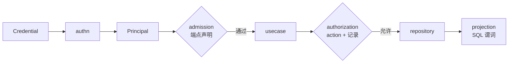

# 权限、Scope 与凭据声明（目标设计）

> **状态：已实现。** 第四层（authorization）是 `internal/authz.Decide(principal, action, resource)`（纯函数、编译期 action 枚举、`ErrDenied` 为带 403 的 `StatusError`）；准入门禁是 `internal/router` 的 `endpoint`（`public(reason)` / `optional()` / `session()` / `scoped(scopes...)`）+ 启动期 `verify()`；会话 scope 由 `authz.ScopesForRole` 派生，`RequireScopes` 单路径、`RequireMinRank` 取代 `RequireAdminSession`；`viewer.Context` 以 `Kind` 表达匿名/会话/令牌/系统，角色每请求从 `users` 直读；JWT claims 收敛为 `typ/scope/RegisteredClaims` 并按类型拆成三个解析入口。本文保留设计推导与审查方法（§7 的记录是改造前的快照），现行行为见 [roles-and-permissions.md](./roles-and-permissions.md) 与 [auth-design.md](./auth-design.md)。 本文重写 Ech0 的授权分层、`viewer`/`Principal`、action 与 scope 的关系、JWT claims，以及"如何审查全项目资源"的方法。与 [space-identity-design.md](./space-identity-design.md) 配套：那份定义"谁是谁"，这份定义"谁能做什么"。
>
> **取代：** [access-token-scope-design.md](./access-token-scope-design.md) 的建模部分（scope 分类、`admin:` 前缀协调、端点声明）。该文档的 scope 字符串仍作为迁移基线；实现冲突时以本文为目标。权限清单的现行行为见 [roles-and-permissions.md](./roles-and-permissions.md)。

## 1. 四个问题，四层

授权被混为一谈，通常是因为四个不同的问题共用了"权限"一个词。

| 层 | 问题 | 粒度 | 位置 | 失败形态 |
|---|---|---|---|---|
| Authentication | 谁在调用？ | 凭据 | 边界中间件 | 401 |
| Admission | 这个凭据能进入这个端点吗？ | 端点 × 凭据能力 | 路由声明 + 中间件 | 403 |
| Authorization | 这个主体能对**这条记录**做这个动作吗？ | 记录 | usecase | 403 / 404 |
| Projection | 列表应该返回哪些行？ | 查询 | repository 谓词 | 静默过滤 |



两条铁律：

1. **上层通过不代表下层允许。** 能进入 `POST /api/echos` 不等于能删某条 echo。
2. **下层不能补救上层的遗漏。** 如果 admission 层放行了不该进门的凭据，usecase 里的检查只是第二道锁，不是设计。

现行实现把 admission 与 authorization 都塞进了 `middleware` + 各 service 里的 `!user.IsAdmin`（42 处）。问题不是"检查不够"，而是**同一件事有两个实现，且没有一处能列出全部**。§7 给出可机械化的审查方法。

## 2. Principal：`viewer` 包的去留

### 2.1 目标形状

```go
type Kind uint8 // Anonymous | Session | Access

type Principal struct {
	Kind     Kind
	UserID   string
	Role     Role      // 来自 users.role，每请求直读，不落 token
	Username string
	Scopes   []string  // 只有 Access 携带；Session 由 Role 派生（见 §4.4）
	Audience []string
	TokenID  string
}
```

匿名是**值**，不是 `nil`，也不是"空 viewer"：

```go
var Anonymous = Principal{Kind: KindAnonymous, Role: RoleAnonymous}
```

理由是决策函数只写一条路径：`Decide(p, action, resource)`，匿名分支是 `p.Kind == KindAnonymous`，而不是每个调用点判空。scope 里永远不会出现 `anonymous:*`。

### 2.2 现行 `pkg/viewer` 的四个问题

| 问题 | 证据 | 后果 |
|---|---|---|
| `IsAdmin()` 与角色重复 | `pkg/viewer/viewer.go` 接口自带 `IsAdmin`；`UserViewer.WithAdmin` 由 JWT claim 填充 | 有了 `role` 后就是第三份真相；且 claim 会过期（≤15 分钟） |
| `TokenType() string` | 字符串比较散落在 middleware/service（`== authModel.TokenTypeSession`） | 拼错即静默放行；应为枚举 |
| `MustFromContext` 静默兜底 | `pkg/viewer/context.go` 找不到值返回 `NewNoopViewer()` | **漏挂鉴权中间件的路由表现为匿名用户**，而不是失败。这类缺陷只能靠启动校验发现，不能靠运行时 |
| `NewSystemViewer()` 返回 Noop | `pkg/viewer/system.go` | 后台任务写入时 `UserID()==""`，于是 `file.UserID != ""` 之类的"空值即系统"分支（`internal/service/file/file.go:306,724,748`）成为隐式约定 |

### 2.3 决定

- **保留包名 `pkg/viewer`**（35 个文件在引用，改名收益小于成本），但把 `Context` 收缩为 `Principal` 的只读视图：`Kind() Kind`、`Role() Role`、`UserID()`、`Scopes()`、`Audience()`、`TokenID()`。
- **删除 `IsAdmin()`**。它的每一个调用点都必须回答"是 rank 问题还是 scope 问题"，而这两者的修法不同。
- **`MustFromContext` 的兜底保留**，但补一条结构性测试：所有非 `public` 前缀的路由必须挂在带鉴权中间件的组上（§7.2）。运行时兜底是便利，不是安全边界。
- **系统主体**显式化：`viewer.System` 带 `Kind=KindSystem`，`UserID` 为空但 `Kind` 明确，产物写出时不再靠空字符串推断。

## 3. Action：必须显式建模，但不是数据库表

### 3.1 为什么 action 要成为一等公民

RBAC/ABAC 的判定单位是三元组 `(subject, action, object)`。如果 action 只存在于 handler 方法名里：

- 策略无法引用它（`Decide` 的参数只能传字符串）；
- 审计无法命名它（日志里只有 URL）；
- 测试无法枚举它（"有没有漏掉某个动作"不可判定）；
- 文档与代码无法对齐（§5 的矩阵只能靠人肉维护）。

所以 action 应当是**编译期枚举 + 集中注册**：

```go
type Action string

const (
	EchoRead      Action = "echo:read"
	EchoWrite     Action = "echo:write"
	EchoDelete    Action = "echo:delete"
	EchoReadPrivate Action = "echo:private"
	CommentModerate Action = "comment:moderate"
	UserManage      Action = "user:manage"
	...
)
```

命名直接复用 scope 字符串：**一个词汇表，两个谓词**。`echo:delete` 作为 scope 表示"凭据可以尝试删除类动作"，作为 action 表示"对该记录执行删除"。不要发明第二套 `echo.delete.any` 命名——两套名字必然漂移。

### 3.2 为什么不建 `permissions` / `roles` 表

| 理由 | 说明 |
|---|---|
| 演进成本 | action 随代码发布变化；放库里每次都要迁移 + 回填 + 兼容旧数据 |
| 审查成本 | 代码里的常量能被 `rg`、能被编译器、能被测试遍历；库里的行只能靠 SQL |
| 性能 | 每请求查权限表（或缓存 + 失效）换来的灵活性当前无人使用 |
| 漂移 | 表与代码是两份真相，需要额外的同步任务 |
| 安全默认 | 漏插一行 = 静默拒绝；漏写一个常量 = 编译失败或测试失败 |

**何时才值得建表**：需要非开发者编辑策略、需要多租户自定义角色、需要策略变更审计历史。当前三个都不成立。届时的起点是 `roles` + `role_permissions` + `principal_roles`，而不是把 action 塞进 KV。

### 3.3 决策函数

```go
// 纯函数、无 IO：给定主体、动作、已加载的资源属性。
func Decide(p viewer.Principal, act authz.Action, res authz.Resource) authz.Decision

type Resource struct {
	Kind   string  // echo | comment | file | user | setting
	ID     string
	Author string  // 资源归属者
	Visibility Visibility // public | members | private
	Status   string
}
```

- `Resource` 是**已加载的属性快照**，由 usecase 在拿到记录后构造；`Decide` 不知道数据库。
- 秩（`rank(role)`）只用于用户管理（`admin` 不能管理 `admin`/`owner`，见 space 文档 §5.1）。内容域不看 rank，只看 `Author` 与 `Visibility`。把 rank 用于内容会产生"管理员能改别人文章正文"这类语义错误——现行 `echo.UpdateEcho` 恰好允许（`echo.go:253`），这是待决产品问题，不是权限模型问题。
- 表驱动测试遍历 `AllActions() × 角色 × ownership × visibility`，断言与 §5 矩阵一致。

## 4. Scope 与 API 的关系：准入，不是授权

### 4.1 结论

**API 不应与 scope 一对一耦合，但每个端点必须显式声明它接受的最小凭据能力。**

scope 回答"这个凭据能进入这个端点吗"；它不回答"能操作哪条记录"。原因是 scope 活在 token 里，签发时就固定了；而记录归属在请求时才确定。任何试图把归属塞进 scope 的设计（`echo:delete:own`）都会让 scope 数量随资源数相乘。

现行声明层是 `internal/router/admission.go`：`public(reason)` / `optional()` / `session()` / `scoped(scopes...)` 四种准入，`.audience(...)` 收窄令牌受众；`verify()` 在启动与生成 spec 时校验。设计推导如下：

1. **公开必须有原因**：`public()` 不记录"为什么不需要授权"，审查时无法区分"有意公开"与"忘了挂中间件"。
2. **启动校验**：声明了 `secured(..., ScopeXxx)` 但没有任何端点使用、或声明了不存在的 scope、或 `public` 端点没有理由——都应在启动时报错（Kemate `access.Verify` 的做法）。
3. **rank 声明显式化**：现在 `secured()` 靠 `authz.HasAdminScope(scopes)` 的 `admin:` 前缀**魔法**追加 `RequireAdminSession`。加一个不以 `admin:` 开头但语义是管理的 scope（`comment:settings` 就是），rank 门禁就静默消失。

### 4.2 端点声明的四维

参考 Kemate `framework/auth/access`，把 `posture` 变成一张**显式表**而非构造函数组合：

```go
type Endpoint struct {
	Access  Access   // Required | Optional | Public | SessionOnly
	Scopes  []string // 准入所需能力（AND）
	Audience []string
	// 无 MinRank 字段：秩下限由 scope 经 MinimumRole 反查，
	// 秩是能力的函数，不应再有一份可漂移的声明。
	Reason   string  // 仅 Public/Optional 需要：为什么可以无授权
}
```

- **fail-closed**：表里没有的端点默认 `Required` + 最低 rank。漏声明 = 拒绝，不是放行。
- `Verify` 在路由注册后、服务启动前运行：端点存在性、scope 合法性、`Public` 必须有 `Reason`、`SessionOnly` 不得同时声明 scope（矛盾声明）、RPC/HTTP 键不得重复。
- 键用**路由模板**（`POST /api/echos`），不是原始路径，否则参数化路由无法匹配。

### 4.3 端点与 scope 的映射规则

| 规则 | 例子 |
|---|---|
| 声明完成该操作所需的**最小**集合 | `POST /api/echos` → `echo:write`（不需要 `echo:read`） |
| 一个端点可要求多个 scope（AND） | 集成评论 → `comment:write` + audience `integration` |
| 一个 scope 可覆盖多个端点 | `echo:read` 覆盖列表、详情、标签、热榜 |
| 复合端点声明"最大动作"，usecase 逐项细化 | `POST /panel/comments/batch` 声明 `comment:review`，删除项运行时再要求 `comment:delete`（现行 `requireCommentDeleteScope` 已是此模式） |
| 归属、可见性、状态**绝不**进 scope | `comment:delete` 不区分"删自己的"与"删别人的" |
| 列表的可见性用 projection，不用 admission | 匿名访问 `GET /api/echos` 是 `public`；私有行由 `PrivateScope` 谓词过滤，返回 200 而非 403 |

最后一条值得展开：**过滤不是拒绝**。匿名用户请求时间线，得到的是去掉私有行的时间线，不是 403。把这种情况做成 admission 会让前端无法区分"空时间线"与"无权访问"。

### 4.4 Session 不是"拥有全部 scope"

现行 `middleware.RequireScopes` 对 session 直接放行（`internal/middleware/scope.go`）。这让 scope 语义分裂：令牌要逐条检查，浏览器会话全通，管理门禁另靠 `RequireAdminSession` + `IsAdmin` claim。

目标：**session 的 scope 由角色派生**，检查只有一条路径。

```go
scopesForRole(RoleMember) = {echo:read, echo:write, echo:delete, comment:read,
                            comment:write, file:read, file:write, file:delete,
                            connect:read, profile:read, profile:write,
                            echo:private, mcp:read}
scopesForRole(RoleAdmin)  = member ∪ {comment:review, comment:delete,
                            comment:settings, connect:write, connect:delete,
                            admin:site, admin:storage, admin:auth, admin:webhook,
                            admin:agent, admin:data, admin:ops, admin:user}
scopesForRole(RoleOwner)  = admin   // 秩只影响用户管理，不放大能力集
```

好处：

- `RequireScopes` 对两种凭据走同一条逻辑；
- 角色每请求从 `users` 直读（space 文档 §7），降级立即生效，不再依赖 15 分钟的 claim 窗口；
- 管理面板不再需要 `RequireAdminSession` 这个特殊中间件，`RequireMinRank`（下限由 scope 反查）取代它；
- `sessionOnly`（账户安全、令牌管理）仍然独立保留——它是"凭据类型"约束，不是 scope 约束。

`owner` 与 `admin` 的能力集相同是刻意的：所有者的独有能力是**管理管理员与转让所有权**，那是 `user:manage` 内部的分支，不需要范围更大的 scope 集。给 owner 额外的 scope 会让"admin 被降级为 member 时丢掉了什么"难以解释。

### 4.5 scope 内部要分三类

现行 26 个 scope 混装了三种东西：

| 类别 | 成员 | 语义 |
|---|---|---|
| CRUD 能力 | `echo:read/write/delete`、`comment:read/write/delete`、`file:*`、`connect:*`、`profile:*` | 允许尝试某类动作 |
| 可见性修饰 | `echo:private` | 读取非公开内容（不是动作） |
| 管理域 | `admin:*`、`comment:review`、`comment:settings` | 治理能力，按爆炸半径拆分 |

分类不是为了改名（已签发的 token 与 OAuth consent 依赖字符串），而是为了**在代码与文档里分组**：可见性修饰不参与 `Decide` 的动作匹配，只参与 projection；管理域的 scope 经 `MinimumRole` 反查即得 admin 下限，不再依赖前缀。

## 5. 目标决策矩阵

`—` 表示拒绝；`own` 表示仅资源归属者；`any` 表示不看归属。

| 资源 | 动作（scope） | 匿名 | member | admin | owner | 谓词 |
|---|---|---|---|---|---|---|
| echo | `echo:read` | ✓ | ✓ | ✓ | ✓ | 仅公开行 |
| echo | `echo:read` + `echo:private` | — | ✓ | ✓ | ✓ | 非公开行 |
| echo | `echo:write` | — | ✓ | ✓ | ✓ | 创建；编辑限 `own`（现行 admin 可改他人，待定） |
| echo | `echo:delete` | — | `own` | `any` | `any` | |
| tag | `echo:delete` | — | — | ✓ | ✓ | |
| comment | `comment:read` | ✓ | ✓ | ✓ | ✓ | 仅 approved；目标 echo 的可见性 |
| comment | `comment:write` | ✓ | ✓ | ✓ | ✓ | 匿名需 captcha + form-token |
| comment | `comment:review` / `comment:delete` | — | — | ✓ | ✓ | 审核、批量、删除 |
| comment | `comment:settings` | — | — | ✓ | ✓ | **现缺守卫，见 §7.3** |
| file | `file:read` / `file:write` / `file:delete` | — | `own` | `any` | `any` | 公开媒体另有无鉴权路由 |
| user | `profile:read` / `profile:write` | — | `own` | `own` | `own` | |
| user | `admin:user` | — | — | ✓ | ✓ | rank 规则：只能管理 rank 更低者 |
| setting | `admin:site/storage/auth/webhook/agent/data/ops` | — | — | ✓ | ✓ | |
| access token | `sessionOnly` | — | ✓ | ✓ | ✓ | 仅交互会话；不用 scope |
| migration | `admin:data`（`/migration/*`） | — | — | ✓ | ✓ | 快照导出含全库 |
| connect | 实例信息（`/connect`、`/connect/list`、`/connects/info`） | ✓ | ✓ | ✓ | ✓ | 无 scope，有意公开 |
| connect | `connect:read`（`/connects/health`） | — | ✓ | ✓ | ✓ | |
| connect | `connect:write` / `connect:delete` | — | — | ✓ | ✓ | 现行 service 内 `!IsAdmin` |
| mcp | 每个工具各自 scope | — | ✓ | ✓ | ✓ | 工具级绑定，见 `internal/mcp/adapter_*` |

## 6. JWT claims

### 6.1 目标 claim 集

| claim | session | access | refresh | 理由 |
|---|---|---|---|---|
| `sub` | user id | user id | user id | 主体，唯一稳定标识 |
| `typ` | `session` | `access` | `refresh` | 三类令牌不可互换；解析时按类型校验 |
| `scope` | **不写**（由 role 派生） | 写入 | 不写 | 派生值写入就会过期 |
| `aud` | 站点 audience | 端点 audience | 站点 audience | 受众 ≠ 权限 |
| `jti` | 必填 | 必填 | 必填且轮换时保持 | 撤销的最小单位 |
| `iss` | 必填 | 必填 | 必填 | 多实例/多环境防混用 |
| `iat` / `exp` / `nbf` | 必填 | 必填 | 必填 | |
| `role` | **不写** | 不写 | 不写 | 见下 |
| `is_admin` | **删除** | 删除 | 删除 | 同一事实的第二个副本 |
| `username` | **删除** | 删除 | 删除 | 可变 PII，且每次请求都能从库拿到 |

### 6.2 为什么 role 不进 claim

claim 是签发时的快照。把 role 放进去，意味着：降级、禁用、转让都要等令牌刷新或撤销才生效。现行 `is_admin` 就是这个问题（`internal/middleware/auth.go:77`）。而**每次请求本来就要读 `users` 行**（`status` 已在做，见 `IsAccountActive`），把 `role` 一起读出来的边际成本为零。删除 claim，也就删除了"claim 与库不一致时以谁为准"这个永远解释不清的问题。

### 6.3 为什么 scope 进 access token，而 role 不进

两者不对称是有意的：

- **role 是主体的属性**，库是唯一真相，读取成本为零 → 不缓存。
- **scope 是凭据的授予范围**，签发时就约定，撤销通过 `jti` 黑名单与令牌表记录 → 必须随凭据走。若每次请求查令牌表拿 scope，access token 就退化成不透明令牌，JWT 的意义消失。

代价是 scope 变更要等重签。这是 OAuth 的既定语义（grant 不可静默扩大），接受。

### 6.4 校验要求（现状缺口）

现行 `parseTokenRaw`（`internal/util/jwt/jwt.go:142`）只做签名验证，没有：

| 缺口 | 风险 | 修法 |
|---|---|---|
| 未固定算法 | 算法混淆的唯一屏障是 keyfunc 返回 `[]byte` | `jwt.WithValidMethods([]string{"HS256"})` |
| 未校验 `iss` | 同 secret 的其他系统令牌可被接受 | `jwt.WithIssuer(config...Issuer)` |
| 未校验 `aud` | 为其他受众签发的令牌可被接受（`RequireScopes` 只检查 audience **值合法**，不检查是否匹配本端点） | 端点声明 `Audience`，`requireAudience` 已具备；解析层用 `WithAudience` |
| `ParseToken` 接受两种类型 | 依赖调用方自行判断 | 拆为 `ParseSessionToken` / `ParseAccessToken` |
| `username`/`is_admin` 冗余 | 与库漂移 | 删除 claim + 停止读取 |

`typ` 检查已存在（`ParseToken` 拒绝 refresh），保留。

## 7. 审查全项目资源的方法

"如何审查整个项目的资源进行权限与粒度设计"应当是**可重复的流程**，不是一次性人工盘点。

### 7.1 五步

1. **资源清单**：`internal/model/*` 的目录即资源域，逐个确认哪些有归属（`user_id`）、哪些是全局配置。当前 12 个域：auth、comment、connect、echo、embedding、file、init、job、migrator、oauthserver、setting、user、visitor、webhook。
2. **端点清单**：从两处派生——Huma 的 `api.route(...)`（`internal/router/*.go`）与裸 gin 的 `setupXxxRoutes`。产物必须机器生成（解析 OpenAPI + 路由树），不能手抄。
3. **交叉矩阵**：`资源 × 动作` 打点，标记三种异常：有端点但无 usecase 校验、有校验但无端点（死代码）、有动作但无任何端点（词汇表孤儿）。
4. **结构性测试**（见 7.2）。
5. **启动校验**：`access.Verify`，把"忘声明"变成启动失败。

### 7.2 必须自动化的四条断言

| 断言 | 捕获的问题 |
|---|---|
| 每个非 `public` 路由都挂在带鉴权中间件的组上 | 漏挂中间件（`MustFromContext` 会把它伪装成匿名） |
| 每个 `secured` 端点的 scope ∈ 词汇表，且词汇表里每个 scope 至少被一个端点使用 | 拼错 scope、删除功能后遗留 scope |
| 每个 `admin:` 语义的端点 scope 反查秩 ≥ `RoleAdmin` | `comment:settings` 这类前缀不匹配导致的静默降级（§7.3） |
| `AllActions()` 的每个动作在 `Decide` 中有分支且被矩阵测试覆盖 | 新增动作未接入策略 |

### 7.3 审查已发现的缺陷（现行代码）

| # | 缺陷 | 证据 | 结论 |
|---|---|---|---|
| 1 | `GET /api/panel/comments/settings` 只受 `comment:settings` 保护，service 无 admin 守卫 | `internal/router/comment.go:33`；`internal/service/comment/comment.go:564`（`GetSystemSetting` 无 `requireAdmin`） | 任意已登录 member 可读评论设置。session 绕过 scope 检查是直接原因 |
| 2 | 管理门禁有两套实现 | `middleware.RequireAdminSession`（Huma）与 `service/*` 的 `!user.IsAdmin`（42 处） | 同一事实两个真相；新增端点容易只做对一半 |
| 3 | `secured()` 用 `admin:` 前缀推导 rank | `internal/router/huma.go:83` | `comment:*` 的管理端点不触发 `RequireAdminSession`，只能靠 service 兜底 |
| 4 | `MustFromContext` 静默降级为匿名 | `pkg/viewer/context.go` | 漏挂鉴权 = 匿名可用，而非 500/401 |
| 5 | `SystemViewer` 是 Noop | `pkg/viewer/system.go` | 后台任务写下的记录 `user_id` 为空，于是出现 `UserID != ""` 的隐式分支 |
| 6 | `file:read` 是受限 scope，同资源却有无鉴权路由 | `internal/router/router.go:74`（`/api/files/public/*`） | scope 必须描述真实暴露面；公开媒体应只允许 `public` 分类 |
| 7 | 批量评论端点需要"声明最大的 + 运行时细化" | `requireCommentDeleteScope`（`internal/service/comment/comment.go:917`） | 不是缺陷，是双层模型的正确用法，应写进规范而不是当特例 |

## 8. 迁移顺序（已按此落地）

1. **Principal**：`viewer.Context` → `Kind/Role`，删除 `IsAdmin`；`newViewer` 从 `users` 直读 role（依赖 space 文档的 `users.role`）。
2. **session scope 派生**：`scopesForRole` + `RequireScopes` 单路径；删除 `RequireAdminSession`。
3. **端点声明表**：`posture` → `endpoint{access, scopes, audience, reason}` + `verify()`；秩下限由 scope 反查得出（落地时发现单独声明 `MinRank` 是死字段，已删除），启动失败即暴露缺口。
4. **修缺陷 1/3**：`comment:settings` 端点由 scope 反查得到 admin 门禁，`GetSystemSetting` 补守卫（已落为 `GetSystemSettingForAdmin`）。
5. **JWT claims**：删 `username`/`is_admin`，加算法/iss/aud 校验，拆 `ParseToken`。
6. **策略包**：`authz.Decide` + `Resource`，把 service 里的 `!IsAdmin` 逐处替换为动作调用（先用户管理域，再内容域）。
7. **测试**：§7.2 的四条断言 + 矩阵表驱动测试。

每一步都可独立发布，不需要一次性切换。落地结果对应关系：1→`pkg/viewer`；2→`authz.ScopesForRole` + `middleware.RequireScopes`/`RequireMinRank`；3→`router.Endpoint` + `apiRegistry.verify()`；4→`GetSystemSettingForAdmin` + `comment:settings` 的 rank 下限；5→`jwt.ParseSessionToken`/`ParseAccessToken`/`ParseRefreshToken`；6→`authz.Decide` 覆盖全部 service 守卫；7→`internal/authz/authorize_test.go`、`internal/middleware/scope_test.go`、`internal/router/router_test.go` 与 `internal/router/cli_scope_test.go`。

## 9. 明确不做

| 不做 | 原因 |
|---|---|
| Casbin / OPA / Cedar / OpenFGA | 单空间、资源属性三个，规则可穷举；策略引擎带来的 DSL 与运维成本无回报 |
| `permissions` / `roles` 表 | §3.2；编译期枚举可审查、可测试、零迁移 |
| scope 编码归属（`echo:delete:own`） | 组合爆炸；归属是资源属性 |
| 一个端点一个 scope 的机械映射 | 复合动作、只读修饰、批量操作都会破例 |
| 角色继承（owner 自动获得 admin 的全部新权限） | 隐式继承会在删除 admin 权限时留下意外空洞；用显式能力集 |
| 把 `role` 或 `is_admin` 写进任何令牌 | §6.2 |
| 匿名用户行 | 匿名是 `Kind`，不是数据库状态 |
| 多租户 / 服务身份 | 单实例单空间；Kemate 的 `sub_type=service` 与 `act` 链式代表暂不需要 |
