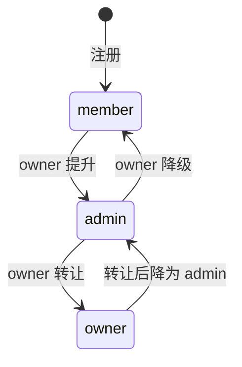

# Space 与身份建模（目标设计）

> **状态：目标设计，未实现。** 本文定义 Ech0 的数据空间、用户身份与角色归属。落地后逐条行为并入 [roles-and-permissions.md](./roles-and-permissions.md)。
>
> **取代：** [user-permission-model-design.md](./user-permission-model-design.md) 的 D2（允许多个 admin、不引入唯一所有者）。本文引入唯一 owner。具体权限清单不在本文范围，另行成文。

## 1. 三个名词

| 名词 | 回答的问题 | 载体 |
|---|---|---|
| Instance | 一次部署 | 进程 + 数据库 |
| Space | 数据空间，容纳全部用户的 Echo | **概念，不物化**（= 本实例） |
| User | 一个人及其凭据、以及他在空间中的角色 | `users` + 三张凭据表 |

```
Instance 1—1 Space 1—N User 1—N Echo
```

一条总原则：**Space 是唯一的数据根。** Echo、评论、文件、标签都通过 `user_id` 归属到 Space，不额外携带 `space_id`——Space 只有一个，那一列恒为常量。

Space 不建表：它没有任何自己的属性（归谁是 `users.role` 的事，站点名在 settings KV）。建一张只有主键、没有自身列的表，只会成为下一次迁移的负担。

## 2. 身份 → 成员 → 所有权

三层必须分开。合成一个布尔就是今天 `users.is_admin` 的问题根源：它同时回答了"是不是管理员"和"空间归谁"。

| 层 | 问题 | 存放 |
|---|---|---|
| Identity | 这个人是谁、能否登录 | `users` + 凭据表 |
| Membership | 他在空间里能治理到什么程度 | `users.role ∈ {owner, admin, member}` |
| Ownership | 这个空间归谁 | 同一个字段里唯一的那一个 `owner` |

`owner` 是角色，但它是**唯一角色**：空间中恰好一个用户持有它。唯一性由数据库的部分唯一索引保证，不由约定保证。

这样 `Principal.Role` 只依赖一行 `users`——鉴权热路径不需要第二次查询、不需要跨表派生、也不需要缓存单例。

## 3. 表设计

### 3.1 users

```sql
CREATE TABLE users (
  id             CHAR(36)     PRIMARY KEY,
  username       VARCHAR(255) NOT NULL UNIQUE,
  email          VARCHAR(255),
  role           VARCHAR(16)  NOT NULL DEFAULT 'member'
                 CHECK (role IN ('owner','admin','member')),
  status         VARCHAR(16)  NOT NULL DEFAULT 'ACTIVE'
                 CHECK (status IN ('ACTIVE','DISABLED')),
  avatar         VARCHAR(255),
  avatar_file_id CHAR(36),
  locale         VARCHAR(16)  DEFAULT 'zh-CN'
);

-- 唯一性：数据库中 owner 至多一个
CREATE UNIQUE INDEX ux_users_single_owner ON users(role) WHERE role = 'owner';
CREATE INDEX idx_users_role ON users(role);
```

`role` 与 `status` 正交：

- `role` 回答"能治理多少"；`status` 回答"能否登录"；
- `DISABLED` 不是角色。把禁用做成角色值和用布尔表达角色是同一类错误；
- 不用软删除字段表达禁用：禁用可恢复且数据保留，删除即真实删除。

### 3.2 凭据表（不变）

`user_local_auth` / `user_external_identities` / `webauthn_credentials` 保持现状。身份与凭据分离：角色变更不动凭据，凭据变更不动角色。

### 3.3 唯一性与转让

`ux_users_single_owner` 只保证 **至多一个** owner。**恰好一个** 由初始化与禁止删除共同保证：

- 未初始化时零个（库已建好，但还没有任何用户）；
- `InitOwner` 写入唯一 owner；
- 除此之外没有任何路径新增或减少 owner——转让是修改，不是增删。

转让是唯一的换值操作，必须按固定顺序在一个事务内完成：

```sql
UPDATE users SET role = 'admin' WHERE role = 'owner';  -- 先降
UPDATE users SET role = 'owner' WHERE id = ?;          -- 后升
```

顺序不能反：SQLite 在 UPDATE 过程中逐行检查唯一约束，先升会当场冲突。这条顺序只允许出现在一个地方——`UserRepository.TransferOwnership(newOwnerID)`，并由一个测试锁定。**禁止**用 `UPDATE ... SET role = CASE ...` 一次换位。

## 4. 秩

| Role | rank |
|---|---|
| member | 1 |
| admin | 2 |
| owner | 3 |

秩只有两个用途：

1. **判断能否作用于某个目标**（见 §5.1）；
2. **校验权限集单调**：`perms(member) ⊆ perms(admin) ⊆ perms(owner)`，用表驱动测试固定。

秩**不推导权限**。具体权限逐条显式定义，避免"owner 自动拥有 admin 的一切"这种隐式继承——在删除某条 admin 权限时，隐式继承会留下预期之外的空洞。

## 5. 不变量

| # | 不变量 | 保证方式 |
|---|---|---|
| 1 | owner 至多一个 | `ux_users_single_owner` |
| 2 | 初始化后 owner 恰好一个 | `InitOwner` 写入；无删除路径 |
| 3 | 无人能删除或降级 owner | `authz.UserManage` 的秩规则 |
| 4 | 只有 owner 能管理 admin、改变所有权 | `authz.UserManage` 的秩规则 + 转让的显式授权 |
| 5 | `DISABLED` 用户不进入任何决策 | `Principal` 解析阶段 403 |

### 5.1 管理关系（秩）

```go
// pkg/role
func (r Role) Rank() int // unknown 0, member 1, admin 2, owner 3

// internal/authz —— 唯一的判定入口
func Decide(p viewer.Context, act Action, res Resource) error
```

所有针对用户写操作（禁用、启用、删除、改角色、踢下线、吊销令牌）都表达为 `authz.Decide(p, authz.UserManage, authz.ForUser(target, assignRole))`：操作者秩必须严格高于目标；若同时授予角色（`assignRole != ""`），还必须严格高于被授予的角色。服务层不再保留 `CanManage` 之类的布尔助手。**守卫只写在"禁用"上是不完整的**：同样能打穿 owner 的路径还包括重置 owner 密码、吊销 owner 的令牌、强制登出。

两条推论，都不需要额外特判：

- **admin 不能禁用 owner**：秩低。
- **admin 不能禁用或降级另一个 admin**：秩相等。否则两名 admin 互相禁用就能让实例失去治理能力。

第 2 条同时消除了旧的 `LAST_ADMIN_REQUIRED` 守卫——owner 必是 admin 之上，且不可降级、不可删除，所以 admin 集合永不为空。

**转让是唯一例外**，不由秩规则派生（`authz.UserTransfer`）：只有当前 owner 可以把所有权交给一个 `role='admin'` 且 `status='ACTIVE'` 的用户。

## 6. 生命周期



| 流程 | 写操作 | 事务 |
|---|---|---|
| 初始化 | `INSERT users(role='owner')` | 单语句 |
| 注册 | `INSERT users(role='member')`，要求已存在 owner | — |
| 提升 | `UPDATE users SET role='admin' WHERE id=?`（actor 为 owner） | — |
| 降级 | `UPDATE users SET role='member' WHERE id=?`（actor 为 owner，目标非 owner） | — |
| 转让 | 先降后升两条 UPDATE | 同一事务，唯一入口 `TransferOwnership` |
| 禁用/启用 | `UPDATE users SET status=?`（走 `authz.UserManage`） | — |
| 删除 | 级联清理（见 user-permission-model-design §6.1） | 单事务 + 提交后删对象存储 |

`InitOwner` 不再需要额外的初始化标记：`EXISTS(SELECT 1 FROM users WHERE role='owner')` 就是"已初始化"。注册守卫与之同源，语义是"没有 owner 的空间不接受任何人加入"。

## 7. 鉴权接入点

```go
type Principal struct {
	Kind   Kind   // Anonymous | Authenticated
	UserID string
	Role   Role   // 来自 users.role，不落 token
	Scopes []string
}
```

每个请求的解析顺序：

1. 解析 token 取 `user_id`（JWT 只放身份，**不放 role**）；
2. 直读 `users` 行取 `role` + `status`；`DISABLED` 直接 403，不进入决策；
3. 组装 `Principal`。

role 不进 claim 是刻意的：降级与转让必须在下一次请求生效，而不是等 token 刷新（现状是 15 分钟窗口）。这一步不增加查询——`status` 本来就要每请求直读。

## 8. 迁移映射

| 现状 | 目标 |
|---|---|
| `users.is_admin = true` | `users.role = 'admin'` |
| `users.is_admin = false` | `users.role = 'member'` |
| 最早创建的 admin（`GetPrimaryAdmin`） | `users.role = 'owner'` |
| 设置里的初始化标记 | `EXISTS(users.role='owner')` |
| `LAST_ADMIN_REQUIRED` | 删除 |

迁移顺序（一次性）：加 `role` 列 → 按 `is_admin` 回填 → 取 `GetPrimaryAdmin` 提为 `owner` → 建唯一索引 → 删 `is_admin` 列 → 删初始化标记。索引必须在回填之后建，否则中途多 owner 会直接失败。

全新部署：`InitOwner` 写入首个用户并直接给 `role='owner'`。

## 9. 明确不做

| 不做 | 原因 |
|---|---|
| `spaces` 表 | Space 没有自己的属性；单例表等于给 settings 加一层间接。需要多空间时再建 `spaces` + `memberships` |
| `memberships(space_id, user_id, role)` | 单空间下恒为 `(1, user_id, role)`，等于给 users 加一列常量 + 一次热路径查询 |
| 内容表加 `space_id` | 归属经 `user_id` 传递，列恒为常量 |
| `roles` / `permissions` 表 | 三个角色是枚举，不是数据 |
| 匿名用户行 | 匿名是 `Principal` 的一个分支，不是数据库状态 |
| 策略引擎（Casbin / OPA / Cedar） | 资源属性只有 `author_id` 与 `kind`，规则可穷举，纯函数更快更可审计 |
| 软删除 / `deleted_at` | 禁用已表达"不可用"，删除即真实删除 |

## 10. 落点

| 层 | 位置 | 动作 |
|---|---|---|
| model | `internal/model/user/user.go` | `IsAdmin` → `Role ∈ {owner, admin, member}`；`AccountState` |
| authz | `internal/authz` | 纯决策函数；`UserManage` / `UserList` / `UserTransfer` 等动作与 `ForUser` 对象 |
| repository | `internal/repository/user` | 角色读写、`TransferOwnership`（先降后升，唯一入口） |
| service | `internal/service/user` | 注册默认 member；提升/降级/禁用/删除调用 `authz.Authorize` |
| service | `internal/service/init` | `InitOwner` 写入 `role='owner'`，初始化状态改查 owner 存在性 |
| middleware | `internal/middleware/auth.go` | 组装 `Principal`，role/status 同一次直读 |
| handler | `internal/handler/user` | 角色列与 owner 行保护；OpenAPI 重新生成 |
| 前端 | `web/src/views/panel` | 角色展示 owner/admin/member；owner 行禁用与删除不可点 |
